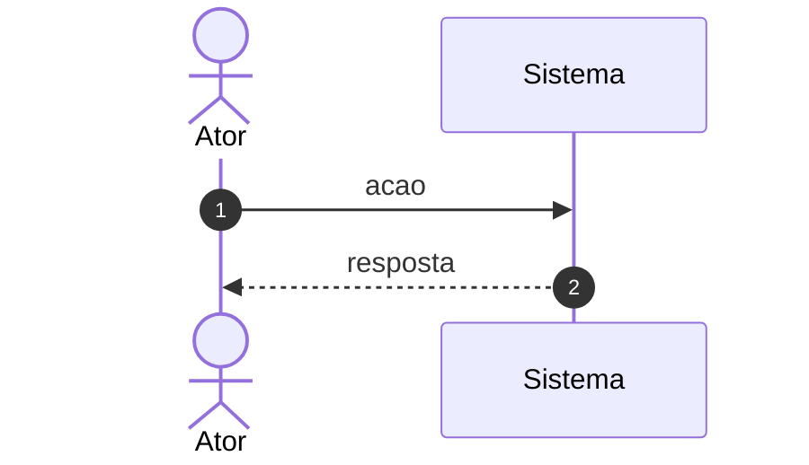

# UC\<n\> — \<Nome do caso de uso\>

> Especificação descritiva. Use **uma única** técnica de detalhamento por caso de uso:
> esta tabela, uma história de usuário, ou um diagrama de atividades. Nunca duas.

| Campo | Conteúdo |
|---|---|
| **Caso de uso** | UC\<n\> - \<Nome com verbo no infinitivo\> \<(Herda de UC\<m\>, se especializado)\> |
| **Objetivo** | Permitir que o ator \<objetivo em uma frase\>. |
| **Requisitos** | RF001, RF002 |
| **Atores** | \<Ator primário\>, \<atores secundários\> |
| **Condição de entrada** | O ator seleciona '\<opção\>' no \<local\>. |
| **Fluxo principal** | 1. O ator acessa a página \<X\>. Ele observa os campos: \<lista\>; opções: \<botões\>. 2. O ator preenche os campos e seleciona \<ação\>. [A2], [A3] 3. O sistema verifica se as informações são válidas. [RN1] 4. O sistema exibe \<resultado\> e a mensagem MSG01. 5. O ator verifica \<confirmação observável\>. |
| **Fluxos alternativos** | **A1 - \<Nome\>** 1. … 2. …  **A2 - \<Nome\>** 1. O ator executa [A1]. 2. …  **A3 - \<Nome\>** 1. … |
| **Fluxos de exceção** | **RN1 - \<Nome da regra\>** \<condição e tratamento\>  **RN2 - \<Nome da regra\>** \<condição e tratamento\> |

## Notas de escrita

- Escreva **"o ator"**, não o nome do papel. Se o ator for renomeado, você não reescreve a
  especificação inteira — o que importa é o papel, não o rótulo.
- Descreva o que o ator **observa** na tela (título da página, campos, opções), não apenas
  o que ele faz. É isso que torna a especificação testável.
- Fluxos alternativos são rotulados `A1`, `A2`, `A3` e referenciados como `[A2]` no ponto
  do fluxo principal em que podem ser disparados.
- Um alternativo pode reaproveitar outro: "O ator executa [A1]".
- Regras de negócio entram como `[RN1]` no passo em que se aplicam, e são detalhadas nos
  fluxos de exceção ou no arquivo de regras de negócio.
- Mensagens do sistema entram como `MSG01`, nunca com o texto escrito direto no fluxo.
- Caso de uso especializado não repete o fluxo do genérico: diz "O ator segue o fluxo
  principal de UC\<m\>" e descreve apenas o que difere.

## Diagrama (opcional)

Só inclua se ele acrescentar algo que a tabela não comunica — e, nesse caso, considere
substituir a tabela em vez de manter as duas.

## Pendências

- ⚠️ A CONFIRMAR: \<dúvida\>

---
*Última revisão: AAAA-MM-DD | Implementado em: `caminho/arquivo.ext` | Testes: `caminho/teste`*
