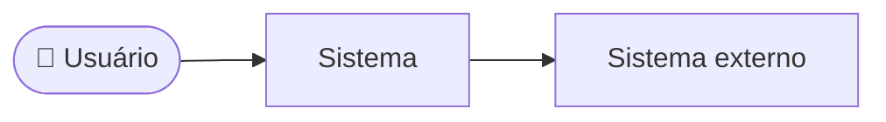

# Documento de Visão do Produto (DVP)

## \<Nome do Sistema\> (\<SIGLA\>)

Versão 1.0

---

## Histórico de revisões

| Data | Versão | Descrição | Autor |
|---|---|---|---|
| DD/MM/AAAA | 1.0 | Criação do documento | \<nome\> |

---

## Sumário

- [Introdução](#introdução)
- [Descrição do problema](#descrição-do-problema)
- [Oportunidades de negócio](#oportunidades-de-negócio)
- [Benefícios do produto](#benefícios-do-produto)
- [Stakeholders e usuários](#stakeholders-e-usuários)
- [Descrição do produto](#descrição-do-produto)
- [Arquitetura ambiental](#arquitetura-ambiental)
- [Restrições](#restrições)
- [Premissas e riscos](#premissas-e-riscos)
- [Pendências](#pendências)

---

## Introdução

Este documento apresenta a visão geral do produto **\<Nome do Sistema\> (\<SIGLA\>)**,
descrevendo o problema a ser resolvido, as necessidades dos stakeholders e as principais
características do produto. Não detalha os requisitos — isso é feito no Documento de
Requisitos.

## Descrição do problema

\<Qual dor existe hoje, quem sofre com ela, como o problema é resolvido atualmente e qual o
custo de não resolvê-lo. Escreva em linguagem de negócio, não em linguagem técnica.\>

| Aspecto | Descrição |
|---|---|
| O problema de | \<descrição do problema\> |
| afeta | \<stakeholders afetados\> |
| cujo impacto é | \<consequência do problema\> |
| uma boa solução seria | \<benefício esperado\> |

## Oportunidades de negócio

\<Que oportunidades o produto abre: modelos de receita, parcerias, expansão de mercado,
ganho de eficiência interna. Uma lista curta e específica vale mais que uma genérica.\>

## Benefícios do produto

| Benefício | Problema resolvido | Afetados |
|---|---|---|
| \<benefício\> | \<problema que ele resolve\> | \<quem é impactado\> |

## Stakeholders e usuários

**Stakeholders** (interessados que não necessariamente usam o sistema):

| Papel | Quem | Interesse principal | Influência |
|---|---|---|---|

**Usuários identificados** (hierarquia de papéis — vira a generalização de atores):

- Usuário do sistema
  - Usuários comuns
    - \<papel\>
    - \<papel\>
  - Administrador do sistema

## Descrição do produto

\<O que o produto faz, em alto nível. Agrupe as necessidades em categorias — elas tendem a
virar os módulos do sistema. Não liste requisitos aqui.\>

| Necessidade | Prioridade | Solução atual | Solução proposta |
|---|---|---|---|

## Arquitetura ambiental

\<Onde o sistema se encaixa: com quais sistemas conversa, quem o acessa e por quais meios.
Diagrama de contexto em alto nível.\>

## Restrições

Percorra os seis tipos; remova os que não se aplicam, mas só depois de checar.

| ID | Tipo | Restrição | Origem / impacto |
|---|---|---|---|
| RE01 | Hardware | \<capacidade de processamento, memória, rede, dispositivos\> | |
| RE02 | Software | \<SO, plataforma, bibliotecas, banco, integrações obrigatórias\> | |
| RE03 | Segurança | \<autenticação, autorização, criptografia, auditoria, backup\> | |
| RE04 | Regulatória | \<LGPD, acessibilidade, normas setoriais, interoperabilidade\> | |
| RE05 | Tempo e custo | \<prazo, orçamento, e o que isso força a priorizar\> | |
| RE06 | Usabilidade | \<acessibilidade, localização, perfil dos usuários\> | |

## Premissas e riscos

| ID | Premissa | Impacto se for falsa |
|---|---|---|
| P01 | | |

| ID | Risco | Probabilidade | Impacto | Mitigação |
|---|---|---|---|---|
| R01 | | | | |

## Pendências

- ⚠️ A CONFIRMAR: \<dúvida em aberto\>

---
*Última revisão: AAAA-MM-DD | Responsável: \<nome\> | Fontes: \<entrevistas, documentos\>*
