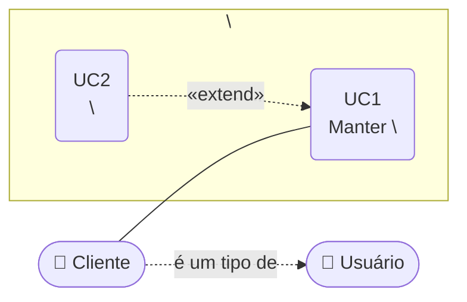

# Visão de Casos de Uso

Exibe as funcionalidades do sistema e como elas são percebidas pelos usuários enquanto
atores que interagem com ele. Público: clientes, designers, desenvolvedores e gerentes de
projeto — o diagrama deve ser compreensível pelo cliente, mesmo que ele nunca venha a vê-lo.

## Atores identificados

| Ator | Descrição | Tipo | É um tipo de |
|---|---|---|---|
| Usuário | Papel genérico de quem acessa o sistema | Pessoa | — |
| Cliente | \<descrição\> | Pessoa | Usuário |
| Administrador | \<descrição\> | Pessoa | Usuário |
| \<Sistema externo\> | \<descrição\> | Sistema | — |

## Diagrama geral de casos de uso

\<Um parágrafo dizendo o que o diagrama mostra e o que deliberadamente omite.\>

> Com mais de ~12 casos de uso, quebre em vários diagramas por módulo em vez de um só.

## Casos de uso

| UC | Nome | Ator primário | RFs atendidos | Técnica de detalhamento | Especificação |
|---|---|---|---|---|---|
| UC1 | Manter \<entidade\> | Cliente | RF001 | Especificação descritiva | [uc1-...](uc1-....md) |
| UC2 | \<nome\> | Cliente | RF002 | História de usuário | [uc2-...](uc2-....md) |

## Extração a partir dos requisitos

Registro da análise que originou os atores e casos de uso acima — é o que permite auditar
as decisões depois.

### Substantivos → atores

| Substantivo | Classificação |
|---|---|
| \<substantivo\> | ator / dado informado / descartado |

### Verbos → casos de uso

| Verbo | Classificação | Caso de uso |
|---|---|---|
| \<verbo\> | funcionalidade / etapa / condição ou ligação | UC\<n\> |

## Pendências

- ⚠️ A CONFIRMAR: \<dúvida\>

---
*Última revisão: AAAA-MM-DD | Responsável: \<nome\>*
