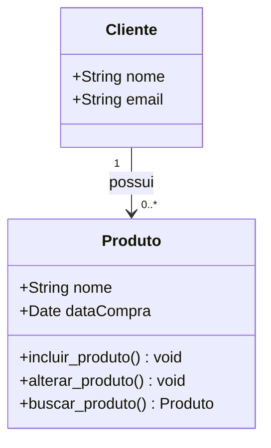
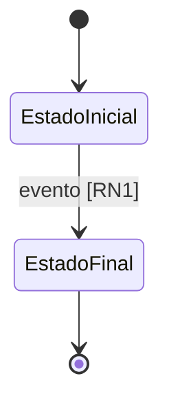

# Visão Lógica

Exibe a estrutura do sistema e como seus componentes interagem — **como** as
funcionalidades são projetadas. Público: designers e desenvolvedores.

## Estilo arquitetural

\<Estilo adotado (camadas, hexagonal, MVC, monolito modular…) e a regra de dependência
entre os módulos: quem pode importar quem. Se não havia arquitetura definida, registre o
padrão escolhido em um ADR e linke aqui.\>

## Extração de classes

Análise dos substantivos das especificações de caso de uso.

| Substantivo | Tipo | Origem |
|---|---|---|
| cliente | classe | UC1 |
| nome do produto | atributo de Produto | UC1 |
| \<substantivo\> | classe / atributo de \<Classe\> / descartado | UC\<n\> |

\<Explique os casos ambíguos: por que "segmento" virou classe e "local de compra" virou
atributo. É essa justificativa que permite alguém discordar de forma produtiva.\>

## Extração de métodos

Análise dos verbos das mesmas especificações.

| Verbo | Tipo | Operação |
|---|---|---|
| cadastrar o produto | operação de Produto | `incluir_produto` |
| \<verbo\> | operação de \<Classe\> / descartar / desnecessário / redundante | `nome_da_operacao` |

## Diagrama de classes

\<Um parágrafo sobre o que o diagrama mostra. Apresente em versões durante a construção:
v1 classes+atributos, v2 relacionamentos, v3 métodos.\>

## Ciclo de vida das entidades

\<Máquina de estados das entidades com campo de status. Muita regra de negócio mora aqui.\>

## Padrões transversais

| Aspecto | Como é feito neste sistema |
|---|---|
| Autenticação | |
| Autorização | |
| Validação | |
| Tratamento de erro | |
| Transação | |
| Log e auditoria | |

## Rastreabilidade

| Classe / módulo | Casos de uso atendidos | Local no código |
|---|---|---|
| Produto | UC1, UC2 | `src/dominio/produto/` |

## Pendências

- ⚠️ A CONFIRMAR: \<dúvida\>

---
*Última revisão: AAAA-MM-DD | Responsável: \<nome\>*
