# Diagramas — sintaxe de referência

Todos os blocos abaixo são modelos prontos para copiar e adaptar. Padrão da skill é
Mermaid embutido no Markdown; PlantUML aparece só onde Mermaid não cobre bem.

Conteúdo:
1. Casos de uso
2. Classes / modelo de domínio
3. Sequência
4. Estados
5. Atividades (fluxo)
6. Entidade-relacionamento
7. Componentes
8. Implantação
9. C4 (contexto e contêineres)
10. Diagrama de requisitos (rastreabilidade)
11. Erros comuns de sintaxe

---

## 1. Casos de uso

Mermaid **não tem** diagrama de casos de uso nativo. Duas saídas.

Antes da sintaxe, as convenções que valem para as duas: caso de uso começa com **verbo no
infinitivo**; um CRUD completo sobre a mesma entidade colapsa em `Manter <entidade>`;
identificadores `UC1`, `UC2`, sem zeros à esquerda; retângulo delimitando a fronteira do
sistema (ou de um módulo). O diagrama precisa ser compreensível pelo cliente — se depende
de explicação técnica para ser lido, simplifique.

### 1a. Emulação em Mermaid (renderiza em qualquer lugar — preferida)

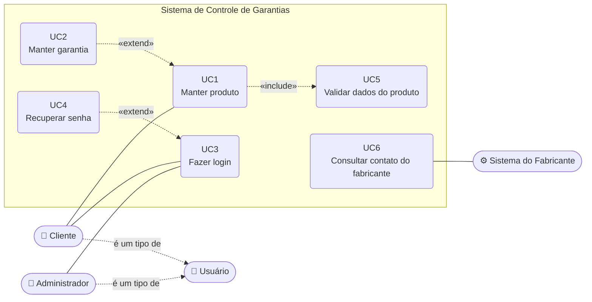

Convenções de desenho: atores como `([texto])`, casos de uso como `("texto")`, fronteira
como `subgraph`, associação ator–UC com linha cheia `---`, relações entre UCs com linha
tracejada `-.->` rotulada. Use `<br>` para quebrar linha dentro do nó.

**Atenção ao sentido das setas**, que é a fonte nº 1 de erro nesse diagrama:

| Relação | Semântica | A seta sai de | e aponta para |
|---|---|---|---|
| `<<include>>` | obrigatória — o incluído **deve** ser executado | o UC incluidor | o UC incluído |
| `<<extend>>` | opcional — o extensor **pode** ser disparado | o UC extensor | o UC estendido |
| generalização | "é um tipo de" | o especializado | o genérico |

No exemplo: `Manter produto` **inclui** `Validar dados do produto` (não dá para cadastrar
sem validar), enquanto `Manter garantia` **estende** `Manter produto` (o cliente pode ou
não cuidar das garantias naquele momento). O mesmo vale para `Recuperar senha`, que estende
`Fazer login`.

Um ator pode ter associação direta com um UC que também estende outro. `Cadastrar-se`
estende `Fazer login` e, ao mesmo tempo, pode ser acessado direto da página principal —
nesse caso, desenhe as duas relações.

### 1b. PlantUML (UML formal, quando exigido por norma acadêmica ou corporativa)

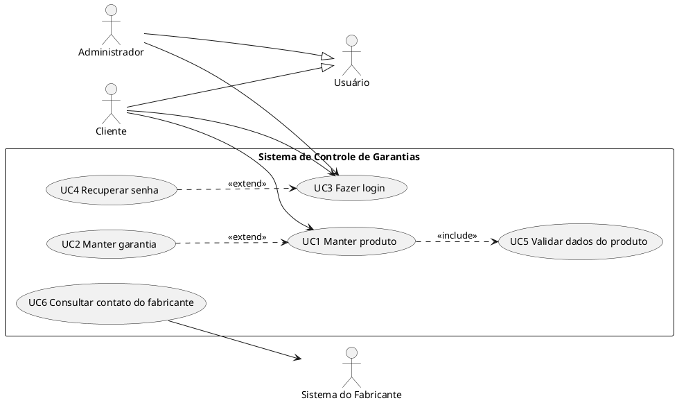

Em PlantUML, `--|>` é generalização e `..>` é a dependência usada para include/extend.

Salve como `.puml` ao lado do `.md` e referencie, ou use bloco ```plantuml no Markdown
(renderiza no GitLab; no GitHub precisa de extensão/CI que gere a imagem).

---

## 2. Classes / modelo de domínio

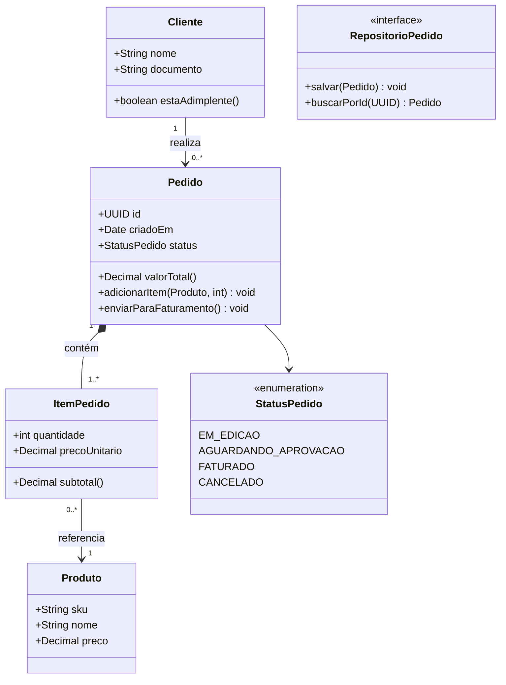

Relações: `-->` associação, `*--` composição, `o--` agregação, `<|--` herança,
`<|..` implementação de interface, `..>` dependência. Multiplicidade entre aspas nas pontas.
Visibilidade: `+` público, `-` privado, `#` protegido.

Para modelo de domínio na visão lógica, prefira mostrar **um agregado por diagrama** com
suas entidades e objetos de valor; a visão geral de todos os agregados vira um diagrama
de pacotes separado.

---

## 3. Sequência

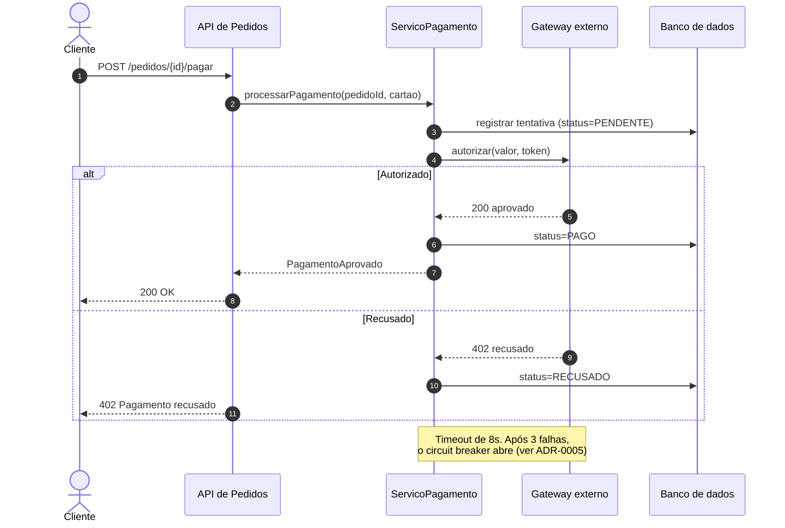

`->>` chamada síncrona, `-->>` retorno, `-)` mensagem assíncrona, `+`/`-` ativação (cada `+` precisa de exatamente um `-` em todos os caminhos de `alt`). Não use `;` em texto de mensagem ou nota: no diagrama de sequência ele separa instruções.
Blocos: `alt/else`, `opt`, `loop`, `par`, `critical`, `break`.

---

## 4. Estados

Ideal para documentar ciclo de vida de entidade — muitas regras de negócio moram aqui.

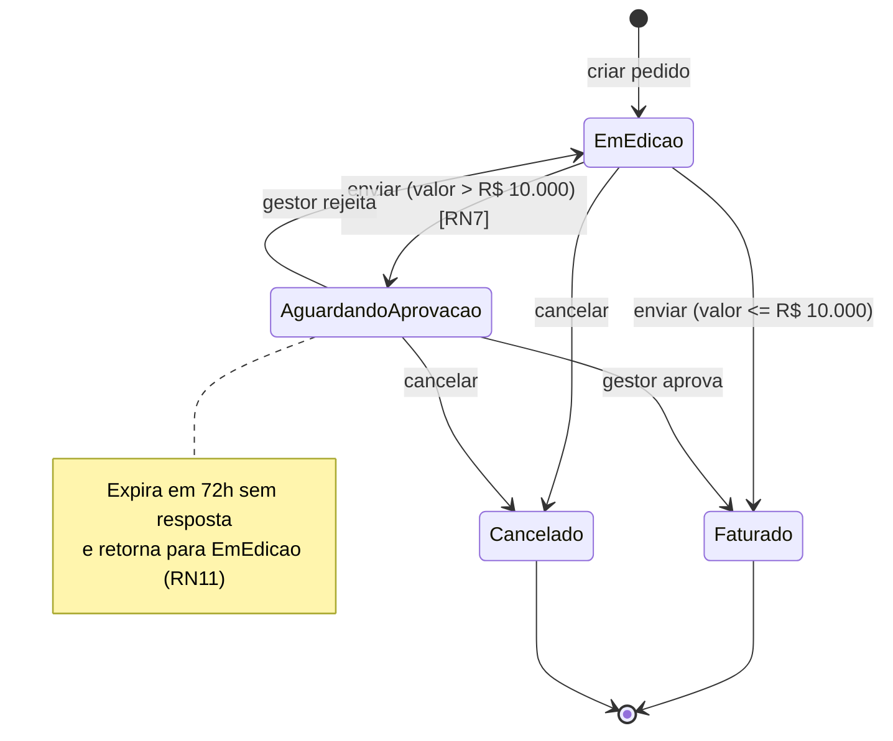

---

## 5. Atividades / fluxo de processo

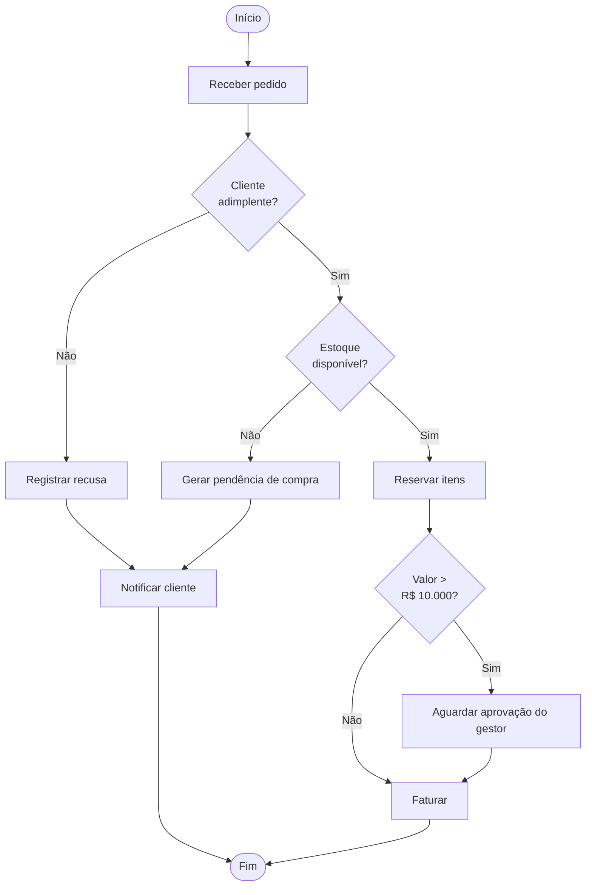

Para raias (quem faz o quê), use `subgraph` por ator:

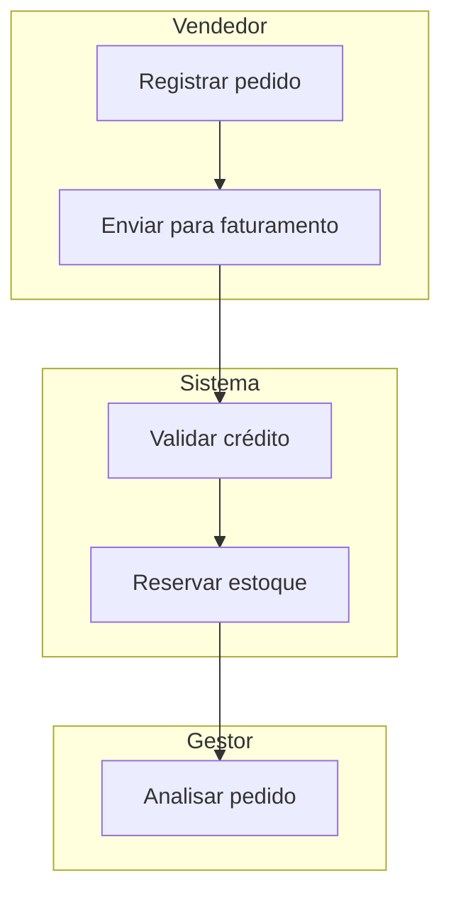

---

## 6. Entidade-relacionamento

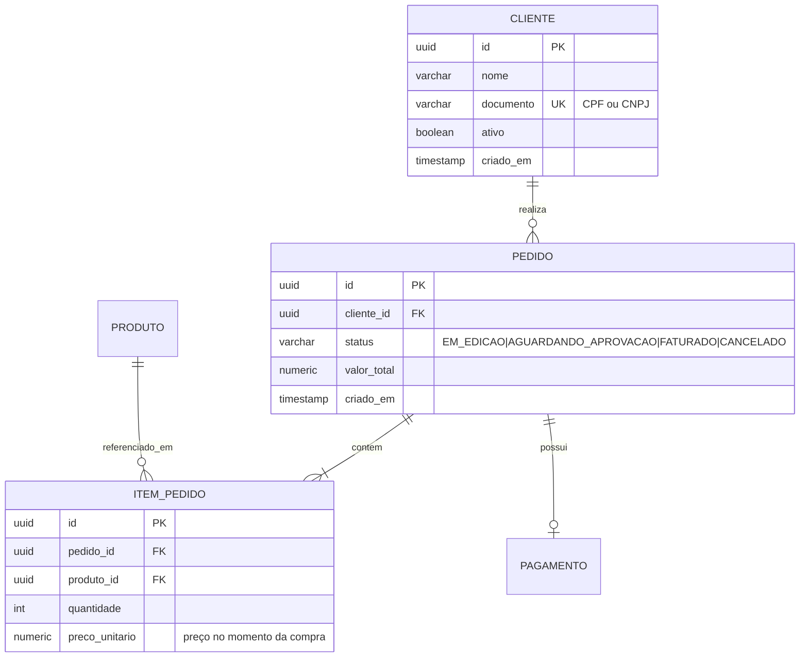

Cardinalidade: `||` exatamente um, `o|` zero ou um, `}|` um ou muitos, `}o` zero ou muitos.
Lado esquerdo lê-se de fora para dentro: `||--o{` = um para zero-ou-muitos.

---

## 7. Componentes

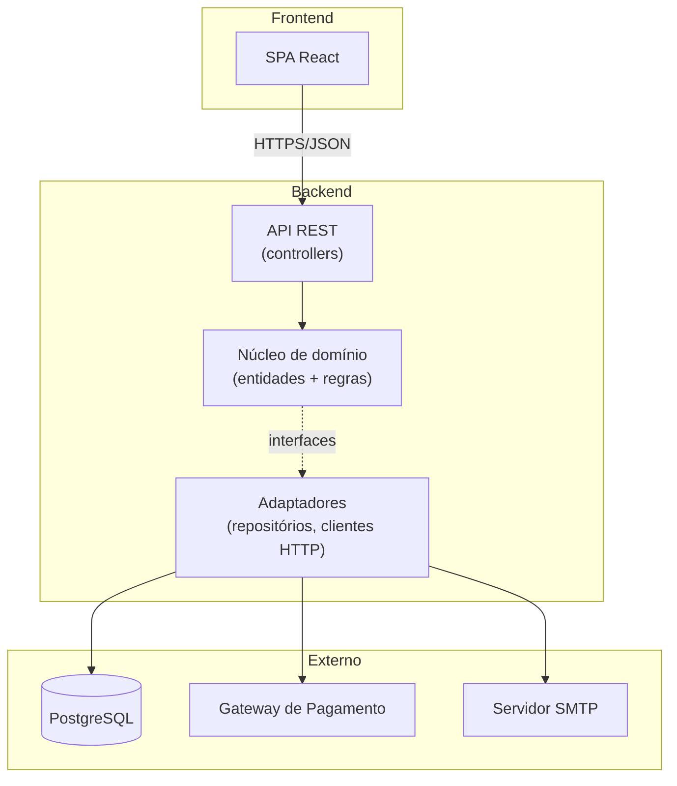

A seta tracejada de `dominio` para `infra` comunica inversão de dependência: o domínio
declara a interface, a infraestrutura implementa. Se a arquitetura do projeto for essa,
mostre isso explicitamente — é a informação mais útil do diagrama.

---

## 8. Implantação

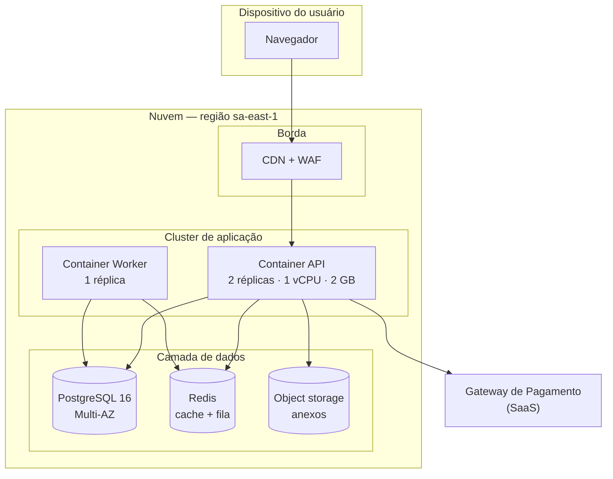

Sempre anote no texto: ambientes existentes (dev/homolog/prod), como o deploy acontece,
onde ficam segredos, e política de backup. Um diagrama de implantação sem essas quatro
informações não ajuda ninguém em incidente.

---

## 9. C4 — contexto e contêineres

Mermaid tem suporte a C4 (ainda experimental, sintaxe pode variar entre versões). Se
falhar na renderização, caia para `flowchart` com subgraphs como nos exemplos 7 e 8.

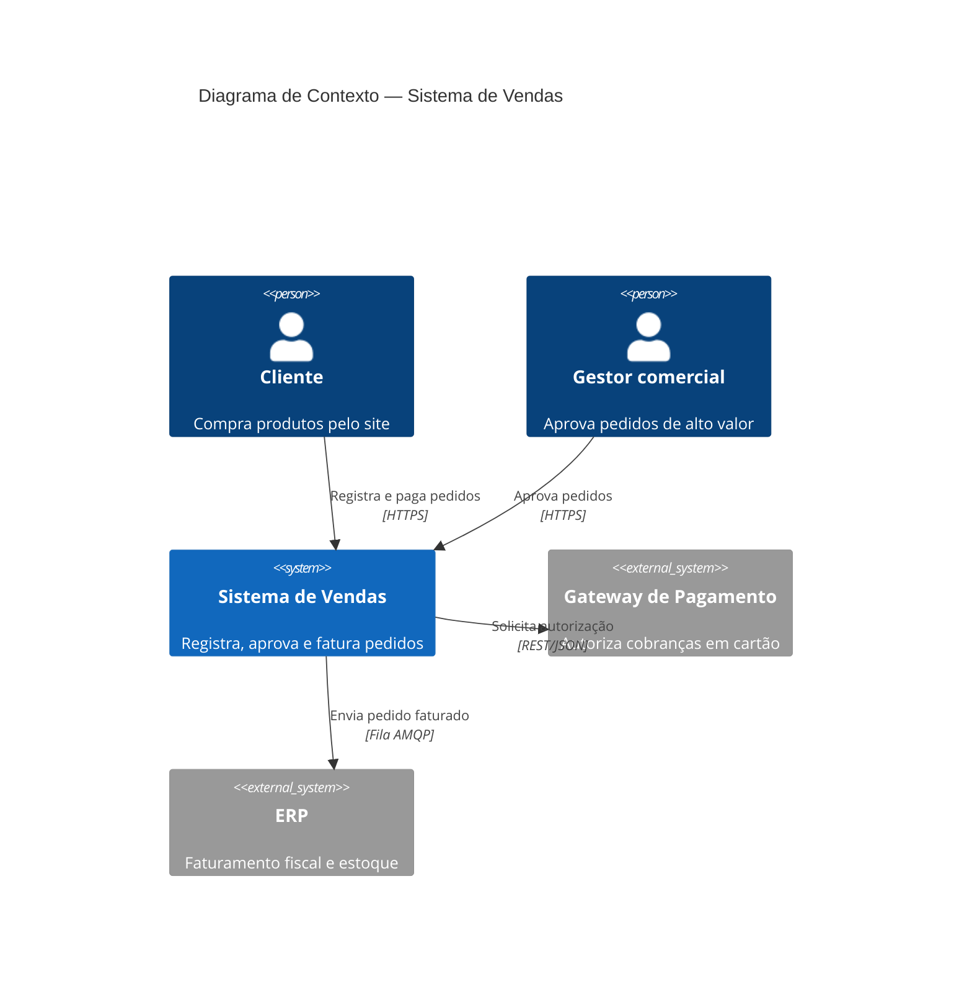

Níveis do C4 e o que documentar em cada um:
- **Nível 1 — Contexto**: o sistema como caixa preta e quem interage com ele. Vai na visão geral.
- **Nível 2 — Contêineres**: aplicações, bancos, filas — unidades que rodam separadamente. Vai na visão de implantação/implementação.
- **Nível 3 — Componentes**: módulos dentro de um contêiner. Vai na visão lógica.
- **Nível 4 — Código**: diagrama de classes. Só para partes realmente complexas; envelhece rápido.

Regra prática: gere sempre os níveis 1 e 2. Nível 3 só para os contêineres não triviais.
Nível 4 apenas onde a lógica é sutil o bastante para justificar.

---

## 10. Diagrama de requisitos (rastreabilidade)

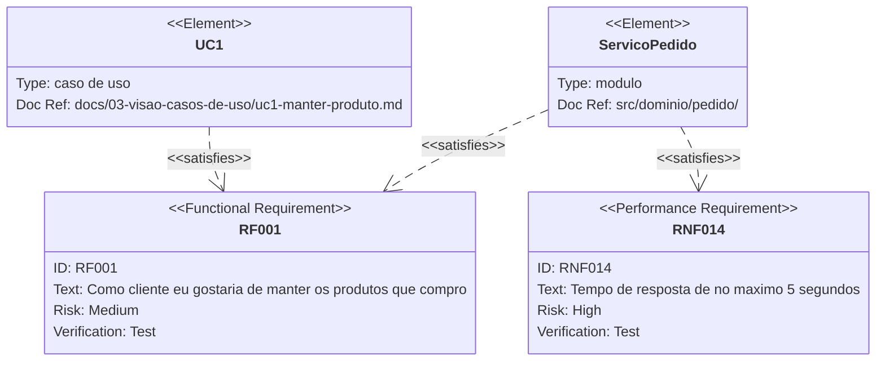

Valores com hífen, barra ou espaço (como `docref` e `text` longos) vão entre aspas.
Tipos aceitos: `requirement`, `functionalRequirement`, `performanceRequirement`,
`interfaceRequirement`, `physicalRequirement`, `designConstraint`.
Relações: `contains`, `copies`, `derives`, `satisfies`, `verifies`, `refines`, `traces`.

Use isso só quando a rastreabilidade for exigida formalmente. Para o dia a dia, a tabela
de rastreabilidade em Markdown é mais fácil de manter e de ler em diff.

---

## 11. Erros comuns de sintaxe

- Parênteses, colchetes, chaves ou aspas **dentro** do texto de um nó quebram o parser.
  Escape com aspas: `no["Pedido (rascunho)"]` funciona; `no[Pedido (rascunho)]` não.
- Acentos são aceitos, mas o **id** do nó deve ser ASCII sem espaço: `nao_aprovado["Não aprovado"]`.
- `end` como texto de nó em flowchart quebra o diagrama — use `Fim` ou `fim([Fim])`.
- Em `classDiagram`, `<<interface>>` e `<<enumeration>>` vão numa linha própria dentro da classe.
- Em `stateDiagram-v2`, nomes de estado não podem ter espaço; use `AguardandoAprovacao` ou
  `s1 : Aguardando aprovação`.
- Em `erDiagram`, o nome da relação não pode ter espaço — use `underscore`.
- Comentários em Mermaid: linha começando com `%%`.

Rode `python scripts/check_mermaid.py <arquivo.md>` antes de entregar; ele pega blocos não
fechados, ids inválidos e os erros acima mais comuns.

---

*As convenções de casos de uso (verbo no infinitivo, "Manter X", sentido das setas de
include/extend e generalização) seguem o material de Maxwell Anderson (IFPB), CC BY-SA 4.0:
<https://maxwellamaral.github.io/lessons/softeng/design/uml_usecase/>*
